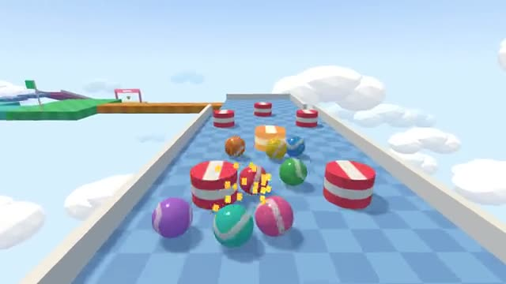

# Marble Dash

Roll your marble to the goal. Don't fall off. A multiplayer starter game from [Multiplayer Agent](https://multiplayeragent.com): 3D, party, 2–8 players, with bots that fill empty seats.

## How it plays

Everyone rolls a marble down the same sky course at once: steep ramps, jumps over gaps, bumpers, moving platforms and a spinning sweeper. Fall off and you go back to the last checkpoint. First to the goal wins.

**Controls:** WASD or arrows to roll, Space to jump, or a stick and a Jump button.

## Make it yours in the Game Builder

Open the [Game Builder](https://multiplayeragent.com), choose **Start from a starter game** and pick Marble Dash. It opens as version 1 in your studio, ready to play and publish. Then ask for changes, for example:

- Add a loop the marbles roll around
- Add ice that makes marbles slide
- Give the winner a golden marble next round

## Run it yourself

1. Get a free publishable key (`pk_…`) at [multiplayeragent.com](https://multiplayeragent.com).
2. In `index.html`, put it in place of `pk_REPLACE_ME` in the `MP_CONNECT` block.
3. Serve the folder (for example `npx serve`) and open it. The 3D engine loads as a module, which browsers block from a file on disk.

Without a key it still runs, offline against bots.

## How it is built

- One `index.html` plus three.js in `libs/`. The comment at the top of the script maps the code and explains the multiplayer.
- The course is a list of pieces in `CONFIG.course` (slopes, jumps, beams, bumpers, movers, the sweeper, checkpoints): reorder them, add more, or change their sizes.
- **Leaderboard:** The fastest runs to the goal.
- **Host-run rounds:** The host's browser starts each round and posts the results; if it leaves, the next player takes over.
- **Bots:** Bots roll with you, and sometimes fall off, until enough people join.
- **Live sync:** Every marble rolls for everyone at once, and the moving platforms run on one shared clock.
- `?attract` runs it offline with bots only. The preview video is recorded from it.

## License

MIT. three.js in `libs/` is MIT too (Copyright 2010-2024 three.js authors).
